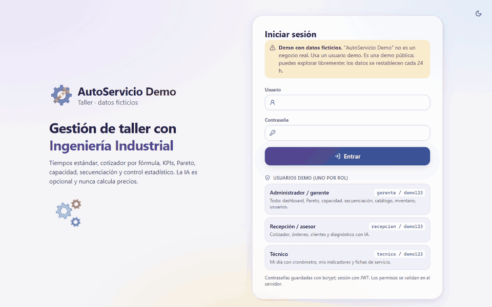
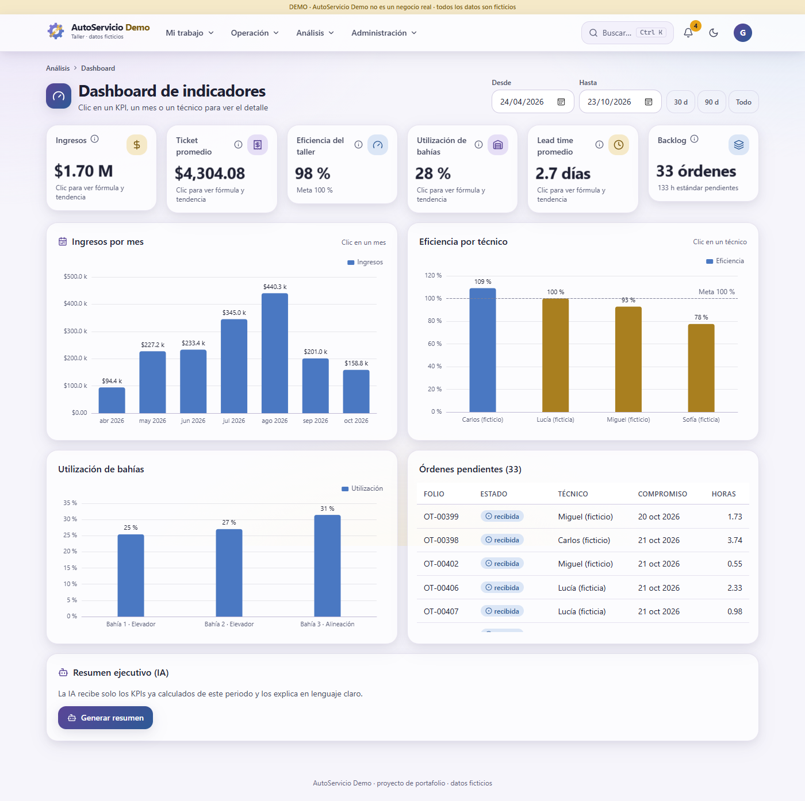

# 🔧 AutoServicio Demo: gestión de taller con Ingeniería Industrial (V2 web)

> ⚠️ **DEMO CON DATOS FICTICIOS.** "AutoServicio Demo" no es un negocio real. Clientes,
> teléfonos, precios, técnicos y órdenes se generaron al azar para un portafolio.

App web para un taller mecánico pequeño (4 técnicos, 3 bahías) que aplica herramientas de
**Ingeniería Industrial**: estudio de tiempos, costeo por tiempo estándar, KPIs, Pareto, carga
contra capacidad, secuenciación, control estadístico e inventario. Tiene **tres roles** con permisos
validados en el servidor y una vista "Mi día" pensada para que los técnicos la usen en el celular.
La IA (Groq) es **opcional**: sin API key la app funciona completa.

- **Backend:** FastAPI + SQLite, reutilizando la lógica probada de la V1 (`src/`). API REST documentada en `/docs`.
- **Frontend:** React + Vite + TypeScript + Tailwind v4 + Framer Motion + Apache ECharts + lucide-react.
- **Producción:** un solo servicio. FastAPI sirve el frontend compilado y se publica gratis en Render.
- La V1 (Streamlit) se conserva en el tag `v1-streamlit`.

## Ver la demo en línea

👉 **https://demo-taller-ia.onrender.com**

Entra con un usuario demo (todas las contraseñas son `demo123`): **gerente**, **recepcion** o **tecnico**.

> ⏳ Está en el plan gratuito de Render: si nadie la usó en los últimos 15 minutos, **la primera carga
> tarda alrededor de un minuto** mientras el servidor despierta. Después responde normal.
>
> 🔒 Es una **demo pública**: puedes explorar y modificar libremente; las acciones destructivas
> (restaurar la base, regenerar datos, borrar o desactivar usuarios, cambiar contraseñas) están
> bloqueadas, y los datos se **restablecen solos cada 24 horas**.





## Roles y usuarios demo

En la pantalla de login hay un botón por cada usuario demo. Todas las contraseñas son `demo123`.

| Rol | Usuario | Qué puede hacer |
|---|---|---|
| Administrador / gerente | `gerente` | Todo: dashboard, Pareto, capacidad, secuenciación, control, catálogo, inventario, usuarios y configuración |
| Recepción / asesor | `recepcion` | Cotizador, órdenes, clientes, catálogo (lectura) e IA de diagnóstico y de WhatsApp |
| Técnico | `tecnico` (Carlos) | **Mi día** con cronómetro, **Mis indicadores** y fichas de servicio (lectura) |

También existen `lucia`, `miguel` y `sofia` (técnicos). Las contraseñas se guardan con **bcrypt** y la
sesión es un **JWT**. Cada endpoint valida el rol en el backend con `require_roles(...)`:
ocultar botones en el frontend es solo comodidad. `tests/test_api.py` recorre una matriz de
32 endpoints × 3 roles.

## Vistas

| Vista | Qué hace | Captura |
|---|---|---|
| Login | Usuarios demo visibles, aviso de datos ficticios, modo claro y oscuro | [login](docs/capturas/login.png) |
| **Mi día** (técnico) | Órdenes ordenadas por prioridad (vencidas, hoy, próximas), botones grandes de iniciar, pausar y terminar con cronómetro, ficha rápida de cada servicio (pasos, tiempo estándar, refacciones). Confeti al terminar | [móvil](docs/capturas/mi-dia-movil.png) · [confeti](docs/capturas/mi-dia-confeti.png) |
| Mis indicadores | Eficiencia personal contra la meta, órdenes terminadas por semana, tendencia y servicios frecuentes | — |
| Servicios | Catálogo con estudio de tiempos (TN, TS) editable por el admin, calculadora de observaciones necesarias, pasos y refacciones | — |
| Cotizador | Fórmula en vivo, diagnóstico con IA, exportación a Excel y PDF, mensaje de WhatsApp (IA) y conversión en orden | [cotizador](docs/capturas/cotizador.png) |
| Órdenes / Clientes | Filtros por estado y vencidas, asignación de técnico, bahía y fecha, avance de estado con tiempo real contra estándar, historial por cliente | — |
| Dashboard | 6 KPIs con conteo animado e inclinación 3D. Clic en un KPI muestra su fórmula, cálculo y tendencia; clic en un mes, sus órdenes, ingresos por servicio, comparativo y técnicos destacados; clic en un técnico, su eficiencia, utilización, tendencia y servicios | [mes](docs/capturas/dashboard-modal-mes.png) · [oscuro](docs/capturas/dashboard-oscuro.png) |
| Pareto | Drill-down en tres niveles con breadcrumbs: servicios → servicio (histórico mensual, técnicos, real contra estándar, gráfica de control) → órdenes → detalle de cada orden | [nivel 2](docs/capturas/pareto-nivel2.png) |
| Capacidad | Carga contra capacidad semanal por técnico, con alerta de sobrecarga y vista de 12 semanas | — |
| Secuenciación | FIFO, SPT y EDD con técnicos **y bahías** como recursos y comparativa de reglas. En la tabla de secuencia (filtrable por técnico) asignas **prioridades a mano** (flechas o número) y **pasas órdenes a otro técnico**; el **Gantt por días laborables** se recalcula al instante y resalta la orden elegida. **Guardar / reasignar** fija prioridad, técnico, bahía y fecha, y la vista Mi día de cada técnico respeta ese orden | [secuenciación](docs/capturas/secuenciacion.png) |
| Control estadístico | Gráfica X̄ de individuales ±3σ y gráfica **X̄-R** por subgrupos, con filtro por técnico | [control](docs/capturas/control.png) |
| Inventario | Stock, demanda diaria, stock de seguridad, punto de reorden, EOQ, cobertura y movimientos | [inventario](docs/capturas/inventario.png) |
| Usuarios / Configuración | Cuentas y roles; tarifa, margen, meta de eficiencia, nivel de servicio, respaldo y restauración de la base, regeneración de datos | — |

La navegación es una barra superior con menús por área, búsqueda, notificaciones por rol, cambio de
tema y menú de usuario. **Ctrl+K** abre una paleta de comandos que busca módulos, servicios, órdenes
y técnicos ([captura](docs/capturas/paleta-ctrl-k.png)). En celular el menú se convierte en un cajón lateral.

### Identidad visual

- **Design tokens** en un solo archivo, `frontend/src/styles/tokens.css`: colores claro y oscuro, sombras, radios, espaciado y tipografía.
- **Paleta:** dorado, azul y morado en versiones apagadas y pastel. Todo el texto cumple **WCAG AA** (≥ 4.5:1, verificado). Las series de las gráficas pasaron un validador de daltonismo.
- **Superficies:** vidrio esmerilado ligero, sombras difusas y brillo que sigue al mouse.
- **Logo** SVG original (engrane + llave) en versión completa e ícono, también como favicon.
- **Animaciones de carga** temáticas (engrane, llave apretando un tornillo, pistón y elevador), rotadas por módulo, y skeleton loaders en tablas y gráficas.
- **Globos (tooltips)** que explican cada KPI y fórmula. Confeti al terminar una orden o al alcanzar la meta de eficiencia.
- Respeta *prefers-reduced-motion*.

## Funciones

### Sin IA (núcleo)
- Estudio de tiempos: TN, TS y **número de observaciones necesarias**.
- Cotizador por fórmula con exportación a Excel y **PDF**.
- Órdenes con flujo de 4 estados y registro del tiempo real.
- **Cronómetro del técnico**: el tiempo se reparte entre los servicios según su tiempo estándar.
- **Inventario**: las refacciones se descuentan al terminar una orden.
- Dashboard con ventanas de detalle y Pareto con drill-down.
- Carga contra capacidad semanal.
- Secuenciación con bahías, Gantt y reasignación.
- Gráficas de control X̄ y X̄-R.
- Respaldo y restauración de la base desde Configuración.

### Con IA (opcional, Groq · modelo `qwen/qwen3.8-27b`, configurable con `GROQ_MODEL`)
1. **Diagnóstico → cotización:** a partir de texto libre, la IA sugiere servicios **del catálogo** en JSON validado y descarta los códigos inventados. El precio lo calcula la fórmula.
2. **Resumen ejecutivo** del dashboard, a partir de los KPIs ya calculados.
3. **Mensaje de WhatsApp** con la cotización, usando los importes que dio la fórmula.

Sin key, estas funciones se ocultan con un aviso. Los errores 401, 404 (modelo retirado), 429 y timeout dan mensajes claros.

## Fórmulas

| Concepto | Fórmula |
|---|---|
| Tiempo normal / estándar | TN = TO × factor de calificación · TS = TN × (1 + % suplementos) |
| Observaciones necesarias | n = (z · s / (e · x̄))², con z según el nivel de confianza y e el error relativo |
| Cotización | Subtotal = (Σ horas estándar × tarifa + refacciones) × (1 + margen) · Total = Subtotal × 1.16 |
| Ticket promedio | Ingresos ÷ órdenes cerradas |
| Eficiencia | Σ horas estándar ÷ Σ horas reales. Se excluyen los registros con tiempo real < 25 % del estándar (suelen ser un cronómetro olvidado) y el resultado se limita a 0–200 % |
| Utilización | Σ horas reales ÷ (recursos × días laborables × 8 h) |
| Lead time | Promedio de (entrega − recepción) |
| Pareto | % acumulado de mayor a menor; la clase A llega hasta el 80 % |
| Secuenciación | Inicio = máx(técnico libre, bahía libre) · Flujo F = C · Retraso T = máx(0, C − d) |
| Control X̄ (individuales) | LC = x̄ · LSC/LIC = x̄ ± 3σ (LIC ≥ 0) · racha de 7 puntos del mismo lado |
| Control X̄-R | X̄: X̿ ± A2·R̄ · R: LSC = D4·R̄, LIC = D3·R̄ |
| Inventario | SS = z·σd·√L · ROP = d̄·L + SS · EOQ = √(2DS/H) |

Calendario laboral: lunes a sábado, 8 h por día. Todas las fórmulas viven en `src/` como funciones
puras con pruebas en pytest.

## Correr en Windows

### Con doble clic

Abre la carpeta del proyecto y haz doble clic en **`Iniciar AutoServicio.bat`**. El script:
1. La primera vez crea el entorno de Python, instala las dependencias y compila la interfaz (tarda unos minutos; requiere Python 3.12 y Node.js).
2. Si el puerto 8000 lo ocupa un servidor anterior de la app, lo cierra. Si lo ocupa otro programa, avisa y no lo toca.
3. Arranca el servidor y abre el navegador en http://localhost:8000.

Para detener la app, cierra la ventana negra. Si quieres un acceso directo con el logo, crea uno al
`.bat` y elige el ícono `assets/autoservicio.ico`.

### Desde PowerShell

Requisitos: **Python 3.12** ([python.org](https://www.python.org/downloads/windows/)), **Node.js 20 o superior** ([nodejs.org](https://nodejs.org/es/download), versión LTS) y **Git** ([git-scm.com](https://git-scm.com/download/win)).

```powershell
git clone https://github.com/robertofranco2873/demo-taller-ia.git
cd demo-taller-ia

# Backend
py -3.12 -m venv .venv
.\.venv\Scripts\Activate.ps1          # si falla: Set-ExecutionPolicy -Scope CurrentUser RemoteSigned
pip install -r requirements-dev.txt

# Frontend (compilar una vez)
cd frontend; npm install; npm run build; cd ..

# Arrancar (sirve API + frontend)
uvicorn api.main:app --port 8000      # abre http://localhost:8000
```

La base `data/taller.db` se crea sola con datos ficticios. Para regenerarla: `python -m src.seed`.
La documentación interactiva de la API está en http://localhost:8000/docs.

**Modo desarrollo** (recarga en vivo), en dos terminales:

```powershell
uvicorn api.main:app --reload --port 8000     # terminal 1
cd frontend; npm run dev                      # terminal 2 → http://localhost:5173
```

**Verificación:**

```powershell
python -m pytest -q                       # backend: fórmulas, base de datos, API y permisos por rol
cd frontend; npm run lint; npm run build  # TypeScript y ESLint sin errores
```

**IA opcional:** copia `.env.example` a `.env` y pega tu key gratuita de
[console.groq.com/keys](https://console.groq.com/keys). **No pongas la key en `.env.example`**,
porque ese archivo sí se sube al repositorio.

### Variables de entorno

| Variable | Para qué | Por defecto |
|---|---|---|
| `GROQ_API_KEY` | Activa la IA (opcional). Secreta: solo en `.env` o en el panel de Render | vacía (IA oculta) |
| `GROQ_MODEL` | Modelo de Groq | `qwen/qwen3.8-27b` |
| `APP_TZ` | Zona horaria del taller para "hoy" y "ahora" (en la nube el servidor corre en UTC) | `America/Mexico_City` |
| `DEMO_MODE` | `true` = demo pública: bloquea acciones destructivas y restablece la base al arrancar y cada 24 h | `false` |
| `JWT_SECRET` | Firma de las sesiones. Si falta, se genera uno al arrancar (las sesiones se cierran al reiniciar) | aleatorio |
| `TALLER_DB_PATH` | Ruta de la base SQLite (p. ej. un disco persistente) | `data/taller.db` |

## Deploy gratis en Render

El repositorio incluye un **Blueprint** (`render.yaml`) y un `Dockerfile` de dos etapas con imágenes
fijadas (`node:24.21.0-bookworm-slim` compila el frontend; `python:3.12.14-slim-bookworm` lo sirve con FastAPI).

1. En [render.com](https://render.com) entra con tu cuenta de GitHub.
2. **New → Blueprint** → elige el repositorio `demo-taller-ia` (rama `main`).
3. Render lee `render.yaml`: un *Web Service* Docker en el **plan gratuito** con `DEMO_MODE=true`,
   `APP_TZ=America/Mexico_City` y `JWT_SECRET` generado.
4. Te pedirá el valor de **`GROQ_API_KEY`** (es `sync: false`, nunca está en el repo). Pégala, o déjala vacía para la demo sin IA.
5. **Apply**. El primer build tarda unos 5–10 minutos. Cuando el estado diga *Live*, abre la URL.

Notas del plan gratis:
- El servicio se duerme tras 15 minutos sin uso; el primer acceso tarda alrededor de un minuto.
- El disco es temporal: con `DEMO_MODE=true` la base se regenera al arrancar y cada 24 h, que es justo lo que quiere una demo pública.

## Estructura

```
api/            FastAPI: main.py, core.py (JWT, roles) y routers/ por área
src/            Lógica pura: time_study, quote, kpis, analytics, pareto, capacity, sequencing,
                spc, inventory, orders, workcalendar, export (Excel/PDF), security, db, seed, ai/
frontend/       React + Vite + TS. src/styles/tokens.css (design tokens), lib/, components/,
                layout/ (barra superior, Ctrl+K), pages/
tests/          pytest: fórmulas, base de datos, API, permisos por rol e IA simulada
docs/           reporte-estado.md, guion-video.md, pendientes-v2.md y capturas (incl. recorrido.gif)
Dockerfile · render.yaml
```

## Datos ficticios

`src/seed.py` (semilla fija 42) genera unos 6 meses **relativos a hoy** (en la zona `APP_TZ`), así que
al abrir la demo siempre hay historial reciente, una orden en curso por técnico, solo 2 a 4 vencidas y
algunas listas para entregar:

- 26 servicios con pasos y 30 refacciones con stock y tiempo de entrega.
- Unas 430 órdenes.
- 4 técnicos con eficiencias distintas.
- Estacionalidad.
- Colas por técnico y bahía, retrasos por refacciones y retrabajos.
- Un pico de demanda reciente que genera backlog y algo de sobrecarga.
- Bitácora del cronómetro, movimientos de inventario y usuarios demo.

---
Proyecto de portafolio. **Demo con datos ficticios**; no usar para decisiones reales.
